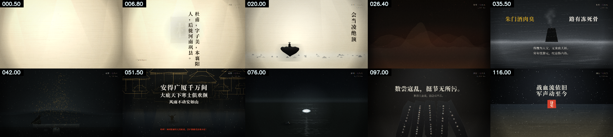

# 杜甫 · 确定性代码渲染短片（V1 / V2 / V3）

一支关于杜甫（712—770）的中文动态图形短片，做了三版。**每一帧都由代码算出来**——没有一张外部图片或视频素材，
纸纹、墨迹、活字、点云群山、广厦线框、刚体断碑全部是 Canvas 逐帧程序化绘制。

| 版本 | 时长 / 帧率 | 声音 | 文字 | 成片（仓库内） | 母版（Release） |
|---|---|---|---|---|---|
| **V1** 诗史 | 85s / 30fps | 男声旁白 + 配乐 | 现代文案 | [720p 预览](output/preview_720p.mp4) · [1080p 压缩](output/v1_share_1080p.mp4) | [v1.0 母版 86MB](https://github.com/leninmd/dufu-motion-graphics/releases/tag/v1.0) |
| **V2** 少陵野老 | 85s / 60fps | 男声旁白 + 配乐 | 现代文案（立意已重构） | [720p 预览](output/v2_release/dufu_v2_preview_720p.mp4) · [1080p 压缩](output/v2_release/dufu_v2_share_1080p.mp4) | [v2.0 母版 250MB](https://github.com/leninmd/dufu-motion-graphics/releases/tag/v2.0) |
| **V3** 万古诗史 | 120s / 60fps | **零旁白**（纯环境音） | **只用原典** | [720p 预览](output/v3_release/dufu_v3_preview_720p.mp4) · [1080p 压缩](output/v3_release/dufu_v3_share_1080p.mp4) | [v3.0 母版 357MB](https://github.com/leninmd/dufu-motion-graphics/releases/tag/v3.0) |



## 三版分别解决什么

- **V1**：证明"代码逐帧渲染"这条路能走通——把抖音上一支苏轼爆款短片的叙事骨架（活字世界 → 风雨 → 江月 → 黑暗自问 → 一手烂牌 → 收束）整体移植到杜甫身上。
- **V2**：修立意 + 上审美库。删掉苏轼式的「无法改变环境／每天都很焦虑／废物」自我内耗，改成杜甫的具身苦难；
  挂载六个开源美学模块（弹簧物理、朱印砸落、风场吹散、刚体预烘焙、字重极差、节奏克隆、质量门），帧率翻倍到 60fps。
- **V3**：把"准绳"提到第一位。**屏幕上每一个字都能在两唐书、元稹墓志、韩愈诗与杜甫原诗里逐字找到**；
  删掉全部旁白，只留环境音与两段硬静默；渲染管线扩到八层（麻纸墨渗 / 参数化广厦晶格 / 多边形断碑 / 气溶胶）。

## 快速开始

```powershell
python tools/fetch_fonts.py                 # 四款字体（本机复制或下载）
python -m pip install numpy opencv-python playwright edge-tts imageio-ffmpeg
python -m playwright install chromium
# ffmpeg：把 imageio_ffmpeg 自带的二进制复制成 tools/ffmpeg.exe（详见 docs/README.md）

python -m http.server 8000                  # 浏览器打开 http://127.0.0.1:8000 实时预览
powershell -ExecutionPolicy Bypass -File .\run_all.ps1      # V1 重建
powershell -ExecutionPolicy Bypass -File .\encode_v2.ps1    # V2（先切分支）
powershell -ExecutionPolicy Bypass -File .\encode_v3.ps1    # V3（先切分支）
```

## 结构

```
storyboard.json / storyboard.v3.json   两代剧本（单一事实来源：章节、HUD、文字）
engine/          theme · layers · kinetic · hud · world3d · water · figures
engine/aesthetics-hub/   六大外挂美学模块（V2 引入）
engine/v3/               八层管线 · 麻纸墨渗 · 广厦晶格 · 多边形断碑 · 气溶胶（V3 引入）
scenes/s01…s09           九个分镜，每个 draw(ctx, 本地时间, 全局时间) 的纯函数
render/render3.py        逐帧 JPEG 写盘 → ffmpeg（断点续渲，支持多端口并行）
render/qa_probe*.py      质量门探针（V2 13 项 / V3 17 项断言）
audio/build_audio*.py    旁白 + 程序化配乐 + 音效（V3 为零旁白环境音）
docs/                    分镜脚本、配方、引文考据、版本档案
```

## 设计约束

* **确定性**：禁用 `Math.random` / `Date.now` / 挂钟时间，随机数一律来自固定种子；同一时间点两次渲染结果一致，可乱序并发、断点续渲。
* **五层 → 八层**：V2 用五层（纸/资产/排版/调色/颗粒），V3 扩到八层（再加体积光、物理特效、气溶胶）。
* **运动**：只用 `outExpo / spring / easeInExpo`，入场 Fade+Rise+Scale+Blur 四属性联动，同屏元素错落 0.05–0.09 秒。
* **文字**：V1/V2 有现代文案；**V3 一个现代字都不写**，全部逐字校对（见 [docs/v3-引文考据.md](docs/v3-引文考据.md)）。

## 三个踩过的坑

1. `ctx.filter='blur()'` 不要用于大量 path——它对每条路径单独软件模糊，草/雨那场单帧从 0.1 秒飙到 20 秒。
2. 8MB 原始帧别经 HTTP 回传再进 ffmpeg：管道背压会让截图卡在 25 秒/帧。逐帧写盘、渲染与编码解耦。
3. 内存紧张时每 120 帧重启一次 Chromium，否则堆增长会让渲染逐步停摆。

详见 [docs/版本档案.md](docs/版本档案.md)、[docs/README.md](docs/README.md)、[docs/storyboard.md](docs/storyboard.md)、
[docs/v3-upgrade-report.md](docs/v3-upgrade-report.md)、[docs/recipe.json](docs/recipe.json)。
