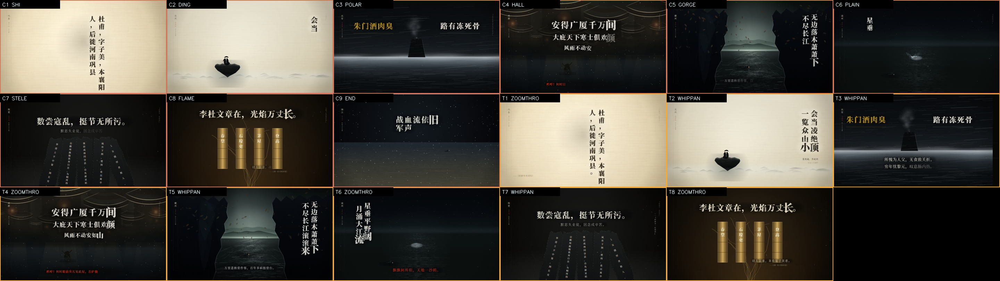

# 少陵测试 · The Du Fu Test（V6.1 外科精修版）

> 人类自古以来就试图用代码编译苦难。
>
> *Since time immemorial, humankind has tried to compile suffering.*

一支 **2 分 18 秒 / 60 fps / 1,920 × 1,080** 的纯代码动画短片。全片 **8,280 帧**、**69 小节 @ 120 BPM**，没有一张外部图片、没有一帧手绘、没有一句机械 TTS 人声：画面由 Canvas 2D 逐帧计算，配乐由 Web Audio `OfflineAudioContext` 合成，第 14 版块的刚体坍塌由 Matter.js 离线预烘焙。

故事只有一条线：一个背着诗卷的行者杜甫，沿一条贯穿全片的 4,739 公里地平线，穿过 18 个时代／媒介，最后在 2026 年的深色代码编辑器里被重新写成漫天星辰。

> **V6.1**：时间轴、目录结构与跨框调度器与 V6 完全一致，只做帧级外科手术 —— 清除 10 处画面遮挡／字符重影／构图瑕疵，并对 04／05／11／14／15 五个版块做密度升级。逐项说明见 [`docs/v6.1-polish-report.md`](docs/v6.1-polish-report.md)，新的画面质量门是 [`tools/qa-v6-1.mjs`](tools/qa-v6-1.mjs)（27 项专项像素探针 + 54 格三小节核查表）。

## 交付物

| 产物 | 路径 |
|---|---|
| 交互式预览 | [`preview/index.html`](preview/index.html) · `node tools/server.mjs 5180` 后打开 |
| **1080p 母版（V6.1）** | `output/v6_1_master/dufu_test_v6_1_1080p.mp4` |
| 1080p 分享版（V6.1） | `output/v6_1_master/dufu_test_v6_1_1080p_share.mp4` |
| **720p 分享版（V6.1）** | `output/v6_1_master/dufu_test_v6_1_720p_preview.mp4` |
| V6.1 画面质量门 | `node tools/qa-v6-1.mjs` → `output/v6_1_qa/qa_v6_1_report.json` |
| 结构质量门 | `node tools/qa-gate.mjs` → `output/v6_qa/qa_report.json` |
| 18 时代接触表 | `output/v6_pelican_paradigm/contact_sheet_18_eras.png` |
| 54 格三小节核查表 | `output/v6_qa/contact_sheet_beats.png` |
| V6.1 精修报告 | [`docs/v6.1-polish-report.md`](docs/v6.1-polish-report.md) |
| 完整工程记录 | [`docs/v6-production.md`](docs/v6-production.md) |
| 分镜简报 | [`briefs/`](briefs/) |

## 18 个版块

| # | 版块 | 年份 · 里程 | 计算艺术核心 |
|---:|---|---|---|
| 01 | 汉唐石刻拓片 | 712 · 0 km | 阈值腐蚀式拓片、花岗岩噪点、白线车马 |
| 02 | 吴道子白描 | 731 · 420 km | 湍流贝塞尔飘带、可变宽墨线、一笔狂草 |
| 03 | 三维水墨点云 | 736 · 705 km | 35,000 点正交点云，90° 坍缩成孤峰 |
| 04 | 盛唐泥金界画 | 746 · 1,037 km | 一点透视宫门、1,600 字三维活字、宫门焊死 |
| 05 | 宋代尺页账簿 | 751 · 1,037 km | 宋代尺页、筹算符号、十字物理压弯驴背 |
| 06 | 构成主义切割 | 755 · 1,150 km | 硬边构成、鎏金巨字挤压、寒霜碎片 |
| 07 | 表现主义木刻 | 755冬 · 1,420 km | 刀痕排线、磁带 0.7937× 熔毁、四拍跳针、裂谷 |
| 08 | 金属球体挤压 | 757 · 1,880 km | 260 颗 PBR 暗金球、预计算堆积、家书压成窄缝 |
| 09 | 关中镂空皮影 | 759 · 2,600 km | 10 fps 关节皮影、可见操纵杆、空铁丝 |
| 10 | 离屏粒子草堂 | 761 · 3,100 km | 8,000 汉字粒子屋顶、γ(t)=0.012× 子弹时间、雨珠静止 |
| 11 | 北宋巨碑山水 | 766 · 3,880 km | 分形皴法巨碑、15× 微距推镜、人如 8 像素 |
| 12 | 八大山人写意 | 768 · 4,350 km | 85% 留白、正弦法线水面 shader、180 粒子沙鸥 |
| 13 | 绿色荧光示波器 | 770 · 4,739 km | 圆形 CRT、余辉、ECG → 李萨如 → 绿字 |
| 14 | 刚体物理坍塌 | 跨时空 | Matter.js 预烘焙 64 体文字废墟、朱砂圈选 |
| 15 | 像素烂牌局 | 人生 | 10 fps 像素血条、3D 透视翻牌、金色暴击 |
| 16 | 千禧年桌面 | 2000s | 虚构 Y2K 系统、256 色抖动、踩点抖窗 |
| 17 | 竖屏弹幕风暴 | 2020s | 9:16 手机、虚构短视频 UI、成百上千条弹幕 |
| 18 | 现代代码美学 | 2026 | 深色 IDE 十六分音符打字、实时编译、1,455 星 |

## 工程结构

```text
src/beat/clock.js       120 BPM · 69 小节 · 18 个版块的时间唯一真相
src/kit/                math / canvas / paper / ink-engine / type / geometry3d
                        particles / frames / hud / debug
src/rig/dufu-rig.js     一套连续的行者 / 瘦驴 / 孤舟参数化木偶
src/scenes/scene_XX.js  18 个纯函数场景：renderAt(ctx, u, beat, env)
src/main/               manifest · film · intro · outro · app · preview-ui
audio/                  Web Audio DSP · 乐器 · 138 s 程序化配乐 · WAV 导出
tools/                  contact-sheet · qa-gate · render · encode · shot · prebake
briefs/                 每版块美术与算法简报 + Scene API
preview/index.html      审片台式交互预览
film.html               1920×1080 纯净渲染面
```

## 运行

```powershell
pnpm install

# 交互式预览（带时间轴、节拍灯、真实 Web Audio 配乐）
node tools/server.mjs 5180
# 打开 http://127.0.0.1:5180/preview/

# 完整流水线
node tools/prebake-collapse.mjs        # 用 Matter.js 预烘焙第 14 版块
node audio/synth-score.mjs             # 生成 output/audio/mix_v6.wav
node tools/render.mjs --workers 4 --resume
node tools/encode.mjs
node tools/contact-sheet.mjs --eras --out output/v6_pelican_paradigm/contact_sheet_18_eras.png
node tools/qa-gate.mjs
```

或者 `npm run build`。

## 确定性约束

- 场景是 `renderAt(ctx, u, beat, env)` 的纯函数；没有 `Math.random()`、`Date.now()`、挂钟时间或无种子物理。
- 所有随机数来自 `mulberry32` / `hash` / `unit`；静态纹理用 `KIT.layer` 缓存。
- 同一时刻两次渲染的像素哈希一致；`tools/qa-gate.mjs` 对 18 个版块做双渲染哈希、文字框边界、HUD 单调里程和所有过框时刻的校验。
- 渲染输出为 60 fps；第 09、15、16 版块内部的皮影／像素／窗口动作被有意量化为 10 fps，而全局镜头仍为 60 fps。

## 音乐

一串原创五声羽调动机 `A4 C5 D5 E5 G5 E5 D5 C5 A4` 贯穿全片。每个版块换一种程序合成音色：大提琴、古琴、编钟、琵琶、笛、箫、堂鼓、示波器正弦、芯片音乐、MIDI 弹窗、Lo-fi、钢琴——全部由 Web Audio 实时合成，没有采样与录音。第 07 版块的盛唐磁带先以 151.2 BPM、+4 半音渲染，再以 `playbackRate → 0.7937`、0.6 Hz 抖动和四拍跳针播放。

## 素材与许可

**片中无一笔外部图像、无一段外部音频。** 代码、画面、音乐均为本项目原创。第三方工具、字体和架构参考的许可见 [`THIRD_PARTY_NOTICES.md`](THIRD_PARTY_NOTICES.md)。

---

# 历史版本（V1–V4）

一支关于杜甫（712—770）的中文动态图形短片，做了四版。**每一帧都由代码算出来**——没有一张外部图片或视频素材，纸纹、墨迹、活字、皴法群山、界画广厦、金石断碑全部是 Canvas 逐帧程序化绘制。

| 版本 | 时长 / 帧率 | 声音 | 文字 | 成片（仓库内） |
|---|---|---|---|---|
| **V1** 诗史 | 85s / 30fps | 男声旁白 + 配乐 | 现代文案 | 720p 预览 · 1080p 压缩 |
| **V2** 少陵野老 | 85s / 60fps | 男声旁白 + 配乐 | 现代文案（立意重构） | [720p 预览](output/v2_release/dufu_v2_preview_720p.mp4) · [1080p 压缩](output/v2_release/dufu_v2_share_1080p.mp4) |
| **V3** 万古诗史 | 120s / 60fps | 零旁白（numpy 噪波） | 只用原典 | [720p 预览](output/v3_release/dufu_v3_preview_720p.mp4) |
| **V4** 长卷 | **88s / 60fps** | **物理建模古琴 + 堂鼓（音画同步）** | 只用原典 + 句读律动 | [1080p 分享 25.6MB](output/v4_release/dufu_v4_share_1080p.mp4) · [720p 预览 8.4MB](output/v4_release/dufu_v4_preview_720p.mp4) · [母版 76MB](output/v4_release/dufu_v4_master_1080p60.mp4) |



## 四版分别解决什么

- **V1**：证明"代码逐帧渲染"这条路能走通——把抖音上一支苏轼爆款短片的叙事骨架（活字世界 → 风雨 → 江月 → 黑暗自问 → 一手烂牌 → 收束）整体移植到杜甫身上。
- **V2**：修立意 + 上审美库。删掉苏轼式的「无法改变环境／每天都很焦虑／废物」自我内耗，改成杜甫的具身苦难；
  挂载六个开源美学模块（弹簧物理、朱印砸落、风场吹散、刚体预烘焙、字重极差、节奏克隆、质量门），帧率翻倍到 60fps。
- **V3**：把"准绳"提到第一位。**屏幕上每一个字都能在两唐书、元稹墓志、韩愈诗与杜甫原诗里逐字找到**；
  删掉全部旁白；渲染管线扩到八层（麻纸墨渗 / 参数化广厦晶格 / 多边形断碑 / 气溶胶）。
  ——但它"看不下去"：120 秒零旁白 + 数学噪波 + 八层发灰 + 理工科线框。
- **V4**：**减法手术**。120s → 88s；八层 → 五层；点云 → 皴法；线框 → 界画；多边形 → 碑拓；火柴人 → 减笔；
  数码 HUD → 朱丝栏夹注；机械入场 → 三种句读律动；分镜孤岛 → 1.2s 交叠的一镜到底；
  numpy 噪波 → Karplus-Strong 古琴 + 堂鼓 + 毫秒级音画同步；17 项工程断言 → 22 项（含 5 道美学门控）。

  **完整手术记录见 [docs/v4-upgrade-report.md](docs/v4-upgrade-report.md)。**

## 历史版本快速开始

```powershell
python tools/fetch_fonts.py
python -m pip install numpy opencv-python playwright
python -m playwright install chromium
python -m http.server 8000
powershell -ExecutionPolicy Bypass -File .\run_all_v4.ps1
```

## 历史版本结构

```
storyboard.json / storyboard.v3.json / storyboard.v4.json   三代剧本（单一事实来源）
engine/          theme · layers · kinetic · hud · world3d · water · figures
engine/aesthetics-hub/   六大外挂美学模块（V2 引入）
engine/v4/               笔墨工具箱 inkbrush · 句读律动 cadence（V4 引入）
engine/v3/               五层管线 · 麻纸墨渗 · 界画木构 · 金石碑拓
scenes/s01…s09           九个分镜，每个 draw(ctx, 本地时间, 全局时间) 的纯函数
render/render4.py        逐帧 JPEG 写盘 → ffmpeg（断点续渲，支持多端口并行）
render/qa_probe_v4.py    22 项质量门（17 工程 + 5 美学）
audio/build_audio_v4.py  Karplus-Strong 古琴 + 堂鼓 + 音画同步
docs/                    分镜脚本、配方、引文考据、版本档案、V4 手术记录
```

## 设计约束（历史版本）

* **确定性**：禁用 `Math.random` / `Date.now` / 挂钟时间，随机数一律来自固定种子；同一时间点两次渲染结果一致，可乱序并发、断点续渲。
* **五层**：纸 / 资产 / 大气 / 微尘 / 排版 / 调色 / 颗粒——每一层都有预算，全屏混合的东西一律先打折。
* **文字**：V1/V2 有现代文案；**V3/V4 一个现代字都不写**，全部逐字校对（见 [docs/v3-引文考据.md](docs/v3-引文考据.md)）。
* **节奏**：入场不再是 `Fade+Rise+Scale+Blur × 0.05–0.09s 等差`，
  而是三种物理模型（史笔刀刻 / 杜诗吟诵 / 墓志碑拓）+ 句读停顿，由 `storyboard.v4.json` 的 `cues` 驱动。
* **音画同步**：画面与音轨读同一张 `cues` / `sfx` 表，JS 与 Python 各实现一次同构的 `schedule()`。

## 四个踩过的坑

1. `ctx.filter='blur()'` 不要用于大量 path——它对每条路径单独软件模糊，草/雨那场单帧从 0.1 秒飙到 20 秒。
2. 8MB 原始帧别经 HTTP 回传再进 ffmpeg：管道背压会让截图卡在 25 秒/帧。逐帧写盘、渲染与编码解耦。
3. 内存紧张时每 120 帧重启一次 Chromium，否则堆增长会让渲染逐步停摆。
4. **探针会骗人**。V3 的 17 项断言全绿，成片依然"看不下去"——
   因为它们只能测"有没有黑屏"，测不出"满屏铆钉没有一寸留白"。V4 的留白率门控一上，两个"CG 感"镜头立刻被判死并被重写。

详见 [docs/版本档案.md](docs/版本档案.md)、[docs/README.md](docs/README.md)、[docs/storyboard.md](docs/storyboard.md)、[docs/v4-upgrade-report.md](docs/v4-upgrade-report.md)、[docs/recipe.json](docs/recipe.json)。
