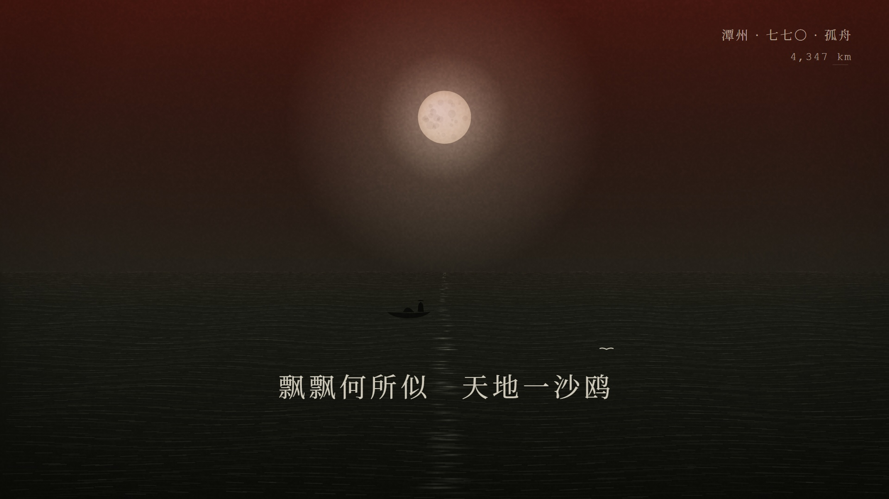

# 杜甫 · 诗史 — 确定性代码渲染短片

一支 **85 秒 / 1920×1080 / 30fps** 的中文动态图形短片：每一帧都由代码算出来，没有一张外部图片或视频素材。
旁白、氛围配乐与音效也全部由脚本生成（edge-tts + numpy 合成）。

> 题材：杜甫（712—770）。叙事骨架与视觉语法逆向自抖音上一支苏轼主题的爆款短片
> （活字世界 → 风雨 → 江月 → 黑色自问 → 一手烂牌 → 收束），本片把素材整体替换为杜甫的生平、诗作与地理轨迹，
> 并按委托改成**沉郁悲壮**的落版。

| 活字版面与朱牌 | 可 · 一手烂牌 | 夜江孤舟 | 终章 |
|---|---|---|---|
|  |  |  |  |

**预览： [`output/preview_720p.mp4`](output/preview_720p.mp4)（9.8 MB，720p，含旁白与配乐）**
1080p 母版 85.9 MB，未入库，用 `run_all.ps1` 可重建。

## 怎么跑

```powershell
python tools/fetch_fonts.py                 # 四款字体（本机复制或下载）
python -m pip install numpy opencv-python playwright edge-tts imageio-ffmpeg
python -m playwright install chromium
# ffmpeg：把 imageio_ffmpeg 自带的二进制复制成 tools/ffmpeg.exe（详见 docs/README.md）

python -m http.server 8000                  # 浏览器打开 http://127.0.0.1:8000 实时预览
powershell -ExecutionPolicy Bypass -File .\run_all.ps1   # 重建全片（约 10 分钟）
```

## 结构

```
storyboard.json   唯一事实来源：九个章节的时间、HUD 提示点、旁白文本与起始时间
engine/           theme(主题/缓动/PRNG) · layers(宣纸/颗粒/暗角) · kinetic(文字动力学)
                  hud(里程状态栏) · world3d(透视活字/点云山) · water(江面/月) · figures(雨/草/舟/墨点)
scenes/s01…s09    九个分镜，每个 draw(ctx, 本地时间, 全局时间) 的纯函数
render/render3.py 逐帧 JPEG 写盘 → ffmpeg 编码（断点续渲、渲染与编码解耦）
render/qa.py      成片质检：容器参数 + 抽帧亮度/运动探针
audio/build_audio.py  旁白 + 程序化配乐/音效 + ducking 混音
docs/             分镜脚本、可复用配方、杜甫生平考证与对调研文档的勘误
```

## 设计约束

* **确定性**：禁用 `Math.random` / `Date.now` / 挂钟时间，一切随机数来自固定种子；同一时间点两次渲染结果一致，
  因此可以乱序并发、断点续渲。
* **五层堆栈**：宣纸/夜底 → 程序化资产 → 排版 → soft-light 调色 → 胶片颗粒 + 暗角。
* **运动**：只用 `outExpo / spring / easeInExpo`，入场 Fade+Rise+Scale+Blur 四属性联动，
  同屏元素错落 0.05–0.09 秒，退场时长约为入场的 40%。
* **HUD**：右上角「地点 · 中文纪年 · 事件 / 累计公里」，里程按真实行程重算（巩县 0 → 潭州 4,739 km）。

## 三个踩过的坑

1. `ctx.filter='blur()'` 不要用于大量 path——它对每条路径单独做软件模糊，草/雨那场单帧从 0.1 秒飙到 20 秒。
2. 8 MB 原始帧别经 HTTP 回传再进 ffmpeg：管道背压会让截图卡在 25 秒/帧。逐帧写盘、渲染与编码解耦。
3. 内存紧张时每 120 帧重启一次 Chromium，否则堆增长会让渲染逐步停摆。

详见 [docs/README.md](docs/README.md)（工程说明）、[docs/storyboard.md](docs/storyboard.md)（分镜脚本）、
[docs/考证与勘误.md](docs/考证与勘误.md)（杜甫生平考证与调研文档纠错）、[docs/recipe.json](docs/recipe.json)（可复用配方）。
